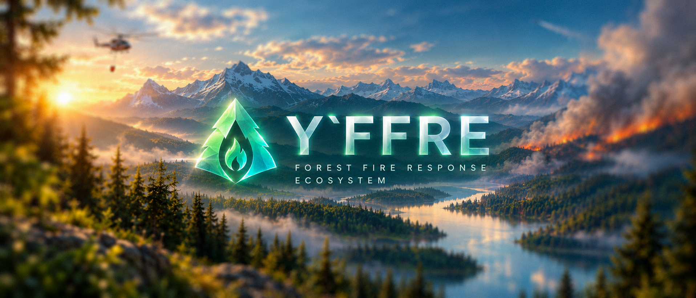
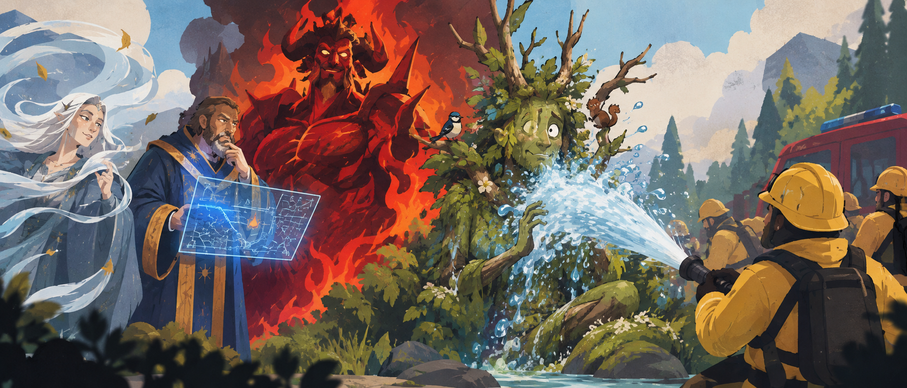

<picture>  
    
</picture>  
  
- - - - - - - - - - - - - - - - - - - - - - - - - - - - - - - - - - -  
  
# Y'FFRE: Forest Fire Response Ecosystem («Ифри»)🌲
  
— Концепция системы поддержки принятия решений для лесопожарных служб при лесных пожарах. 
  
- - - - - - - - - - - - - - - - - - - - - - - - - - - - - - - - - - -
> [!IMPORTANT]
>
> # ❗️ Дисклеймер / Disclaimer ❗ ️
>
> Проект является учебной симуляцией (разработан в рамках хакатона) и разработан исключительно в демонстрационных и
> научно-образовательных целях. 
> 
> Приложение представляет собой изолированную модель. Все рекомендации носят информационный характер, 
> не являются официальными предписаниями и не заменяют экспертные решения профильных специалистов. 
> Продукт не является коммерческим или готовым к промышленной эксплуатации решением.
- - - - - - - - - - - - - - - - - - - - - - - - - - - - - - - - - - -

  

🔮 Лингвистический Апокриф: почему именно так?
  

## 🌿 Y'ffre ➔ Ифри (или Иффри)  
  
### **‍💻 По коду**  
  
Система поддержки принятия решений при лесных пожарах. Её задача — собрать разрозненные сведения о пожаре, территории, погоде и доступных ресурсах в понятную картину происходящего. На основе этих данных система должна помогать оценивать ситуацию, учитывать ограничения и сравнивать возможные варианты действий.

Не всеведущий оракул, предсказывающий каждое событие, — [Джиггалаг](https://elderscrolls.fandom.com/ru/wiki/Джиггалаг) уже показал чем может [закончиться](https://elderscrolls.fandom.com/ru/wiki/Шеогорат) подобная уверенность. И не бездумный ИИ, которому можно безоговорочно доверить управление пожаротушением. Y'FFRE — инструмент, помогающий человеку понимать происходящее и принимать обоснованные решения, когда информация неполна, время ограничено, а цена ошибки высока.
  
### **📖 По лору**  
  
[Y'ffre](https://elderscrolls.fandom.com/ru/wiki/И%27ффре) (также И'ффре, Й'ффер и Джефре), Бог леса и Дух настоящего является самым важным божеством пантеона [лесных эльфов](https://elderscrolls.fandom.com/ru/wiki/Босмеры_(Lore)), и иных народов. Согласно мифологии босмеров, после создания смертного всё пребывало в [хаосе](https://elderscrolls.fandom.com/ru/wiki/Эра_Рассвета), смертные превращались то в животных, то в растения, и обратно, не имея формы. И тогда он отказался от своей личности и превратил себя в одного из первых духов-прародителей смертных — «Кости Земли». Он установил первые правила и принципы жизни, чтобы установить безопасность и законы природы. Таким образом, он сформировал каркас, на котором соткана природа, и, как говорят, обрел способность видеть все, что происходит в поле зрения птиц и отражении воды.  
  
### **📚По языку**  
  
Здесь начинается самое интересное: `Y'ffre` — не то имя, которое очевидно читается по правилам английского языка.
Апостроф, удвоенная согласная и непривычное сочетание букв выглядят так, будто перед нами имя из языка, для которого привычные правила чтения не подходят.

При этом в английском сообществе нет полного единодушия относительно того, как именно следует произносить `Y'ffre`. У других народов его написание Jephre, тут `ph` читается как «ф» (как в _philosophy_) и получается «Джефри». Почему вообще взялось J? 
А это как с [Йогголагом](https://github.com/EliG0/Jyggalag), у каждого языка и народа Тамриеля звучит по разному.
Другие игроки ориентируются на произношение имени в The Elder Scrolls Online, что звучит ближе к «Ифри» или «Йефри».

В русской локализации The Elder Scrolls укоренилось написание И'ффре. Оно сохраняет исходную форму имени, включая апостроф и удвоенную согласную. Но почему тогда прижилось в проекте Ифри?

Во-первых, это удобнее произносить по-русски, чем каждый раз воспроизводить исходное написание Y'ffre. Название становится коротким и естественным в разговоре.

Во-вторых, Ифри хорошо работает как имя самого проекта, а Y'FFRE — как его визуальная идентичность. Первое удобно произносить, второе — использовать в названии репозитория, логотипе и оформлении документации.

Это не означает, что «Ифри» — единственно правильная транслитерация. Скорее, это практический выбор между сохранением исходного написания и удобством живого языка.

В самом репозитории мы сохраняем оригинальное имя Y'FFRE, а в речи используем привычный вариант Ифри. Написание «Иффри» тоже понятно и сохраняет удвоенную согласную оригинала, но для краткого русского названия проекта предпочтительнее более простая форма.

## 🏛️ Почему именно Y'FFRE?

Во-первых, потому что пожар это не просто горение деревьев или движение ветра. Это комплексный кризис всей экосистемы. Посему **Y'FFRE**, как сущность олицетворения законов природы, стабильности биологических форм, и Бога настоящего - у нас является цифровым фундаментом для принятия решений в условиях хаоса стихии.

Во-вторых, **Y'FFRE** звучит довольно пафосно для хакатона. Оно оставляет пространство для целой экосистемы, в которой могут сосуществовать сбор данных, геоинформационные инструменты, аналитика, правила и поддержка принятия решений. Это также аббревиатура _Forest Fire Response Ecosystem_ (Экосистема реагирования на лесные пожары), а также кодовое имя проекта. Так делают на практике почти во всех крупных разработках, на всех уровнях (включая тот же ФГИС ЛК):

| Официальное название                                                                                                                                                  | Служебный заголовок (Кодовое название) |
|-----------------------------------------------------------------------------------------------------------------------------------------------------------------------|----------------------------------------|
| ИСППР при лесных пожарах                                                                                                                                              | Y'FFRE                                 |
| [программа по разработке ядерного оружия](https://ru.wikipedia.org/wiki/Манхэттенский_проект)                                                                         | Манхэттенский проект                   |
| [Программа пилотируемых космических полетов НАСА по высадке человека на Луну](https://ru.wikipedia.org/wiki/Аполлон_(космическая_программа))                          | Аполлон                                |
| [Android OS (версии 1.5–9)](https://ru.wikipedia.org/wiki/Android#Наименование_версий)                                                                                | Cupcake, Donut, Eclair, Froyo и т.д.   |
| Игровые консоли [Xbox One](https://www.ign.com/articles/2012/02/28/report-next-xbox-codenamed-durango) и [PlayStation 4](https://ru.wikipedia.org/wiki/PlayStation_4) | Durango и Orbis                        |
| [Немецкий танкостроительный зоопарк](https://en.wikipedia.org/wiki/List_of_military_land_vehicles_of_Germany)                                                         | Tiger, Panther, Puma, Marder и т.д.    |

В-третьих, это вопрос конкурентоспособности и запоминаемости. По сравнению с остальными вымышленными названиями типа ПрогнозПожара.ру, ФорестТим и Лесная братва, Y'FFRE запоминается, а значит, запомнится и жюри.

🔥 Примечание для тех, кто дочитал до конца

Бог леса, чьё имя при удалении одной буквы превращается в «огонь» (FFRE - F = FRE ➔ FIRE), а при добавлении одной — в огненного джинна (Ифри + т = [Ифрит](https://ru.wikipedia.org/wiki/Ифрит)). Не самый удачный выбор для лесопожарной системы, зато честный: врага нужно знать по имени.

К тому же Y'ffre пока что единственный на всю серию не [даэдра](https://elderscrolls.fandom.com/ru/wiki/Даэдра_(Lore)). Хотя 
на роль имени претендовали четверо: [Кинарет](https://elderscrolls.fandom.com/ru/wiki/Кинарет) (ветер: главный фактор распространения огня), [Джулианос](https://elderscrolls.fandom.com/ru/wiki/Джулианос) (логика: модели распространения пожара), [Мерунес Дагон](https://elderscrolls.fandom.com/ru/wiki/Мерунес_Дагон) (разрушение: сам пожар) и Y'ffre (лес). Выбрали того, кого тушат.

<picture>  
    
</picture>  

  

- - - - - - - - - - - - - - - - - - - - - - - - - - - - - - - - - - -  
  

<a href="https://github.com/EliG0">It Just Works!</a>
